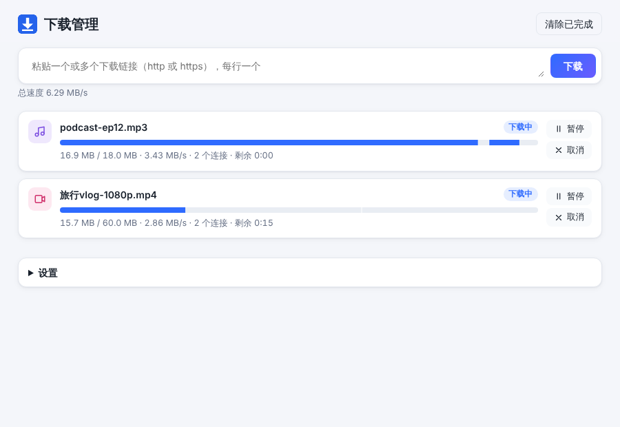

# 下载加速器（Download Booster）· 第一阶段原型

纯插件模式的 MVP：Manifest V3 扩展，用自适应多连接分段下载大文件，无需安装其他软件。名字是暂定的。



## 试用方法（Chrome / Edge）

1. 下载 `download-booster.zip` 并解压到一个文件夹（或直接用本目录）。
2. 打开 `chrome://extensions`（Edge 为 `edge://extensions`），打开右上角“开发者模式”。
3. 点“加载已解压的扩展程序”，选择包含 `manifest.json` 的文件夹。
4. 三种用法：
   - 像平时一样下载大文件（默认大于 20 MB），插件会自动接管，并打开下载管理页；
   - 在链接上右键，选“用下载加速器下载”；
   - 点工具栏图标打开下载管理页，粘贴链接。
5. 完成后文件出现在浏览器的默认下载目录，管理页里点“打开所在位置”。

界面语言跟随浏览器语言（中文或英文）。设置在管理页底部：自动接管开关、接管阈值、每个任务的最多连接数。

## 已实现

| 设计文档 MVP 项 | 状态 |
| --- | --- |
| 接管下载：右键菜单 + 自动接管（> 20 MB，可调） | 已完成 |
| 自适应分段：1 个连接起步，速度近似线性增长时翻倍加连接，增益变小后逐个加，不再提速就退回最佳档；每 20 秒再试探一次更高档。每档要等所有连接都开始收数据、再稳定 1 秒后，取 3 秒平均速度判定 | 已完成 |
| 动态分段：空闲连接切走最大剩余分段的后一半 | 已完成 |
| 不支持 Range 时退回单连接 | 已完成 |
| 暂停 / 继续 / 失败自动重试（指数退避，429/503 自动降并发）；浏览器重启后自动用 `If-Range` 续传 | 已完成 |
| 下载管理页：进度、实时速度、分段可视化、剩余时间、打开所在位置、中英双语 | 已完成 |
| 内置测速对比：单连接速度 vs 平均速度 | 已完成 |
| 防盗链：接管或右键下载时，把来源页面作为 Referer 加到每个分段请求上（`declarativeNetRequest` 会话规则，只作用于本插件自己的请求） | 已完成 |

## 测试结果（本地限速服务器，每个请求 2 MB/s，模拟 nginx `limit_rate`）

运行 `node test/e2e.mjs`（`SIZE_MB=100`），在 Chromium 中加载本扩展，10/10 通过，下载的文件 SHA-256 全部一致：

| 场景 | 结果 |
| --- | --- |
| 单连接基线 | 2.0 MB/s |
| 自适应多连接 | 连接数 1→2→4→6，各档速度 1.9 / 4.0 / 8.0 MB/s；100 MB 全程平均 5.4 MB/s（含爬坡时间，×2.8）。每档约 4 秒判定，大文件上爬坡时间可以忽略 |
| 每个请求首字节延迟 1.5 秒（模拟远程 CDN） | 仍能加到 6 个连接，平均 4.3 MB/s |
| 服务器不支持 Range | 自动单连接，2.0 MB/s |
| 每 4 个请求返回一次 503 | 降一档并冷却 30 秒后再试探，峰值 4 连接，完成 |
| 下载到 27% 时暂停再继续 | 续传请求带 `If-Range`，文件完整 |
| 普通点击下载 100 MB 文件 | 被接管，原生下载已取消 |
| 小于阈值的文件 | 交还浏览器，原生下载正常进行 |
| 校验 Referer 的防盗链文件 | 接管后每个分段请求都带上来源页 Referer，下载成功 |

这只证明引擎在“按请求限速”的服务器上工作正常。真实站点（HTTP/2、CDN）的提速效果还需要按设计文档“下一步”第 2 条实测。

## 代码结构

```
manifest.json          MV3 清单
_locales/{en,zh_CN}    界面文案
src/background.js      Service Worker：右键菜单、自动接管、创建 Offscreen、调用 chrome.downloads 保存
src/offscreen.js       下载引擎宿主（常驻）：任务列表、IndexedDB 持久化、每个任务一个 Worker
src/task-worker.js     单个任务：并发 fetch Range，用 OPFS 同步句柄按偏移写盘
src/scheduler.js       纯逻辑：分段切分、自适应并发控制器、测速（Node 单测覆盖）
src/http.js            纯逻辑：Content-Range / 文件名解析
src/manager.*          下载管理页
test/                  单元测试、限速测试服务器、Playwright 端到端测试
```

开发命令：`npm test`（单元测试）、`npm run test:e2e`（端到端，需要 Playwright）、`npm run serve`（启动本地限速服务器，可用 `http://127.0.0.1:8787/file.bin` 手动试）、`npm run zip`（打包）。

原型阶段为了能直接“加载已解压”，用的是原生 ES 模块，没有构建步骤；设计文档建议的 TypeScript + Vite 可以在 MVP 稳定后再迁移。

## 已知限制

- 隐身窗口的下载不接管（Cookie 不同）。
- 同一站点的连接上限是浏览器给的：HTTP/1.1 最多 6 条，HTTP/2 站点所有分段共用 1 条 TCP 连接，提速只对“按请求限速”有效。第二阶段的本地助手解决这一点。
- 下载过程中文件先写入浏览器内部存储（OPFS），完成后再复制到下载目录，短时间占用双倍磁盘。
- 没有任务队列：添加多少个就同时下载多少个。
