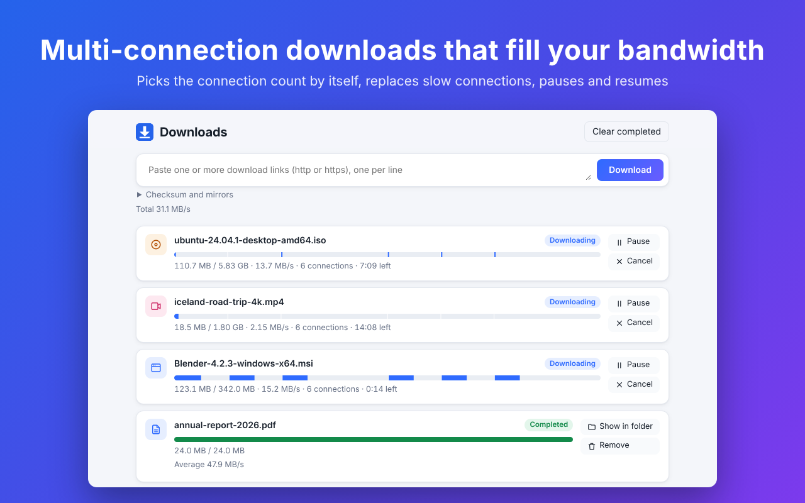
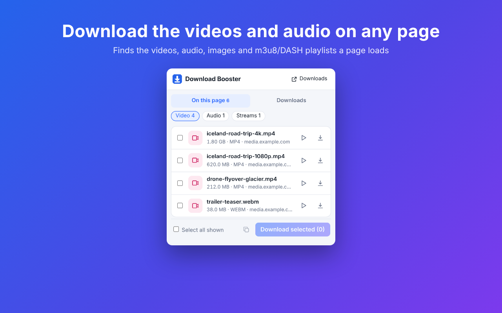
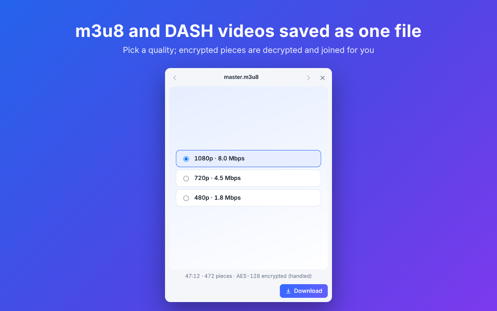

<p align="center">
  
</p>

<h1 align="center">Download Booster</h1>

<p align="center">
  A browser extension for multi-connection downloads: fill your bandwidth on large files without installing a download manager.
  <br>
  English · <a href="README.zh-CN.md">简体中文</a>
</p>



## Features

**Faster downloads**

- Every file starts with up to 6 connections, each downloading its own piece; fewer only when the server refuses more, and they are added back later
- Slow connections are spotted and replaced, and the last pieces are split finer so a download doesn't crawl at the end
- Pause, resume and automatic retries, also after closing the browser
- Every byte is checked before the file is saved; any gap is downloaded first
- Optional mirrors: other addresses of the same file share the work
- Optional MD5 / SHA-1 / SHA-256 check when the download finishes

**Videos, audio and images on a page**

- The toolbar button lists the videos, audio, images and m3u8 / DASH playlists a page has loaded, including ones the player fetches in the background with no link on the page
- Preview before downloading, select several and download them together
- m3u8 (HLS) and DASH: pick a quality; pieces download in parallel, AES-128 encrypted pieces are decrypted, and video and audio are joined into one file
- Record a video that plays from a `blob:` address and save it as MP4

**Your way**

- Takes over browser downloads above a size you choose, or only the ones you send to it
- Global speed limit and number of downloads at once
- Save straight into a folder you pick
- Collect every link on a page, filter by type, download in bulk and rename by a pattern
- English and Chinese, following the browser's language

| Media on a page | Picking an m3u8 quality |
| --- | --- |
|  |  |

## Install

**From the store:** [Chrome Web Store](https://chromewebstore.google.com/detail/chgjgofmencmbmacnllicfamakifofnh) (in review). Edge can install it from the Chrome Web Store too.

**By hand** (Chrome 116 or later, or Edge):

1. Download this repository (Code → Download ZIP) and unzip it.
2. Open `chrome://extensions` (`edge://extensions` in Edge) and turn on Developer mode.
3. Click "Load unpacked" and choose the folder that contains `manifest.json`.

## Use

- **Takeover:** click download links as usual; files over 20 MB (adjustable) go to Download Booster.
- **Right-click:** on a link, video, audio or image choose "Download with Download Booster"; on the page choose "Find downloadable links on this page".
- **Toolbar button:** the media and images on this page and your downloads; the number on the icon counts the videos and audio found.
- **Download manager:** opened from the top right of the toolbar popup. Paste one or more links (one per line) and follow each download's pieces and speed.

Settings are at the bottom of the download manager: takeover and its size threshold, connections per download, downloads at once, total speed limit, save folder and media detection rules.

## Limitations

- The browser caps connections per site: 6 for HTTP/1.1, and 2 TCP connections for HTTP/2 sites.
- Chrome doesn't let an extension write into Downloads, Desktop or Documents themselves; pick a folder inside them, such as Downloads/Download Booster.
- DRM-protected video, live streams and YouTube are not supported.
- Downloads in incognito windows are not taken over.

## Privacy

No data is collected: no account, ads or analytics. Everything stays in your browser, and the extension only connects to the files you download. See the [privacy policy](docs/store/PRIVACY.md).

## Development

Plain ES modules with no build step: edit, then reload the extension on the extensions page.

```sh
npm install         # Playwright, only needed for the tests
npm test            # unit tests
npm run test:e2e    # end-to-end: loads the extension in Chromium, downloads from a local throttled server, checks the files
npm run serve       # local throttled server at http://127.0.0.1:8787/file.bin
npm run zip         # package as download-booster.zip
```

Implementation notes, test records and the code layout are in [docs/DEVELOPMENT.md](docs/DEVELOPMENT.md) (Chinese).

Questions and suggestions: [open an issue](https://github.com/andrewjr1991/download-booster/issues).
