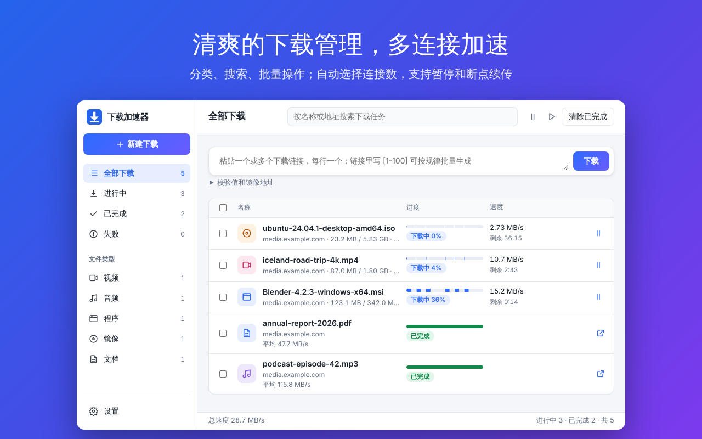
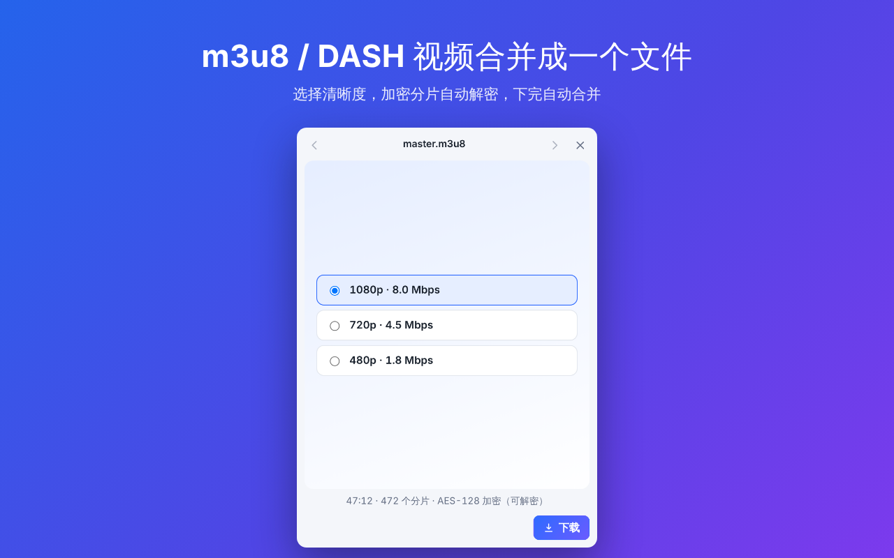

<p align="center">
  
</p>

<h1 align="center">下载加速器</h1>

<p align="center">
  多连接分段下载的浏览器扩展：不用另装下载软件，大文件也能用满带宽。
  <br>
  <a href="README.md">English</a> · 简体中文
</p>



## 功能

**下载更快**

- 每个文件一开始就用最多 6 个连接分段下载，服务器拒绝时才减少，过一会儿再加回来
- 自动发现并换掉慢连接，最后一部分拆得更细，不会在结尾卡很久
- 暂停、继续、出错自动重试，关掉浏览器后也能接着下
- 保存前逐字节核对文件完整，有缺口先补下
- 可以填写同一文件的镜像地址，多个服务器一起分担
- 可以在下完后核对 MD5 / SHA-1 / SHA-256

**网页里的视频、音频和图片**

- 点工具栏按钮，列出网页实际加载过的视频、音频、图片和 m3u8 / DASH 播放列表，包括播放器在后台加载、页面上没有链接的
- 下载前可以预览，可以多选一起下载
- m3u8（HLS）和 DASH：选择清晰度，分片并行下载，AES-128 加密的分片自动解密，画面和音轨合成一个文件
- 地址是 `blob:` 的视频可以录制下来，保存为 MP4

**按你的习惯**

- 自动接管超过指定大小的浏览器下载，也可以只下你主动发给它的
- 全局限速，设置同时下载的任务数
- 直接写进你选的文件夹
- 收集网页上的所有链接，按类型筛选，批量下载并按规则改名
- 界面支持中文和英文，跟随浏览器语言

| 网页资源 | m3u8 选择清晰度 |
| --- | --- |
|  |  |

## 安装

**从商店安装**：[Chrome 应用商店](https://chromewebstore.google.com/detail/chgjgofmencmbmacnllicfamakifofnh)（审核中）。Edge 也可以从 Chrome 应用商店安装。

**手动安装**（Chrome 116 或更新版本，或 Edge）：

1. 下载本仓库（Code → Download ZIP）并解压。
2. 打开 `chrome://extensions`（Edge 为 `edge://extensions`），打开“开发者模式”。
3. 点“加载已解压的扩展程序”，选择包含 `manifest.json` 的文件夹。

## 使用

- **自动接管**：像平时一样点下载链接，超过 20 MB（可调）的文件会交给下载加速器。
- **右键菜单**：在链接、视频、音频或图片上右键，选“用下载加速器下载”；在网页空白处右键，选“嗅探本页的下载链接”。
- **工具栏按钮**：查看本页的音视频和图片、下载进度，图标上的数字是本页发现的音视频数量。
- **下载管理页**：从工具栏弹窗右上角进入，可以粘贴一个或多个链接（每行一个），也能看到每个任务的分段进度和速度。

设置在下载管理页底部：自动接管和大小阈值、每个任务的最多连接数、同时下载的任务数、总速度上限、保存位置和嗅探规则。

## 已知限制

- 同一站点的连接数受浏览器限制：HTTP/1.1 最多 6 条；HTTP/2 站点最多 2 条 TCP 连接。
- 选择保存文件夹时，Chrome 不允许直接选“下载”“桌面”“文档”本身，请选其中的子文件夹，例如“下载/下载加速器”。
- 不支持 DRM 加密的视频、直播流和 YouTube。
- 隐身窗口里的下载不会被接管。

## 隐私

不收集任何数据，没有账号、广告和统计。所有数据都留在你的浏览器里，扩展只连接你要下载的文件。详见[隐私政策](docs/store/PRIVACY.md)。

## 开发

代码是原生 ES 模块，没有构建步骤，改完直接在扩展页面里重新加载即可。

```sh
npm install         # 安装 Playwright（只有测试需要）
npm test            # 单元测试
npm run test:e2e    # 端到端测试：在 Chromium 里加载扩展，从本地限速服务器下载并核对文件
npm run serve       # 启动本地限速服务器，http://127.0.0.1:8787/file.bin
npm run zip         # 打包成 download-booster.zip
```

实现细节、测试记录和代码结构见 [开发说明](docs/DEVELOPMENT.md)。

问题和建议请提交 [Issue](https://github.com/andrewjr1991/download-booster/issues)。
